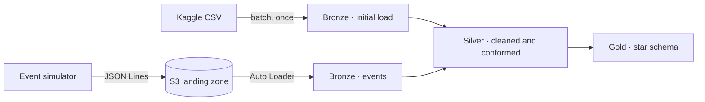

# Madrid Real Estate Lakehouse

End-to-end **batch + streaming lakehouse on Databricks** that models the analytical side of an Idealista-style property portal.

> **Status:** work in progress. This is a personal learning project.

---

## Overview

This project designs and builds the analytical (OLAP) platform of a property sales and rental portal similar to Idealista, using the Databricks Lakehouse platform.

It combines two data sources:

- A **one-time batch load** of ~21,000 real property listings from the city of Madrid (Kaggle dataset).
- A **simulated event stream** that represents what happens on the portal after that initial load: price changes and, later on, new listings.

Data is organised in a **medallion architecture** (bronze → silver → gold) on Unity Catalog, with governed tables, data lineage and incremental ingestion.

---

## Data sources

| Source | Description | Load type |
|---|---|---|
| Kaggle CSV | ~21,000 listings from the city of Madrid. Each row is one listing. | Batch, once |
| Event simulator | Python script that emits portal events (price changes, new listings) as JSON Lines files to S3. | Incremental |

**Why a simulator?** There is no free public feed of listing events (price changes or updates to existing listings), so the simulator generates them on top of the real data.

---

## Architecture

| Layer | Contents |
|---|---|
| **Landing (S3)** | Event files written by the simulator, stored exactly as received. |
| **Bronze** | Raw data from each source with no modifications, preserving lineage and fidelity to the source. |
| **Silver** | Cleaned and typed data. Both sources are merged into common tables, a synthetic property key (`propiedad_key`) is derived, and duplicate events are removed by `event_id`. |
| **Gold** *(planned)* | Star schema: fact tables (publications, price changes) and dimensions (property with change history, neighbourhood, date). |

---

## Key design decisions

### Listings and properties are separate entities

A listing belongs to exactly one property, and a property can have many listings (N:1). The same property often appears in several listings, so keeping both entities makes it possible to answer both *"how many listings are there?"* and *"how many properties are for sale?"*.

The source has no property identifier, so silver derives a synthetic key from stable physical attributes of the property.

### Validity flags decide whether a price is usable

The source includes flags such as `is_rent_price_known`. Some listings have the flag set to `false` and still contain a numeric `rent_price`, so the value alone cannot be trusted. Price validity is decided by the flag, never by the value itself.

The full design rationale is documented in [`docs/design.md`](docs/design.md).

---

## Tech stack

| Area | Tools |
|---|---|
| Platform | Databricks Free Edition: Unity Catalog, Delta Lake, Auto Loader |
| Storage | AWS S3, connected through a Unity Catalog external location |
| Event simulator | Python (pandas, boto3) |
| Planned | Lakeflow Spark Declarative Pipelines, Lakeflow Jobs, Databricks Asset Bundles, GitHub Actions |

---

## Project status

- [x] Data model design
- [x] Unity Catalog setup (`dev` and `prod` catalogs with medallion schemas)
- [x] S3 landing zone connected through an external location
- [ ] Event simulator *(in progress)*
- [ ] Bronze ingestion pipeline
- [ ] Silver and gold layers
- [ ] Orchestration and CI/CD

---

## Limitations

- **Databricks Free Edition:** serverless compute only and daily usage quotas. This shapes some design choices, such as running incremental batches instead of an always-on stream.
- **Simulated events:** listing changes are generated by the simulator rather than consumed from a real API, since no free public source of listing events exists.
